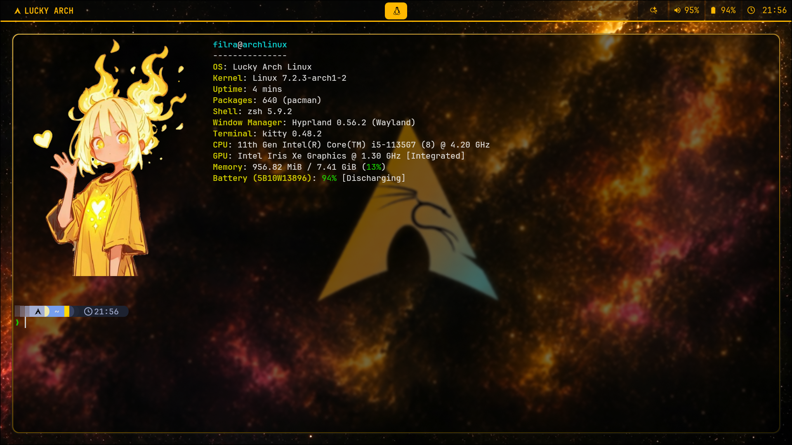
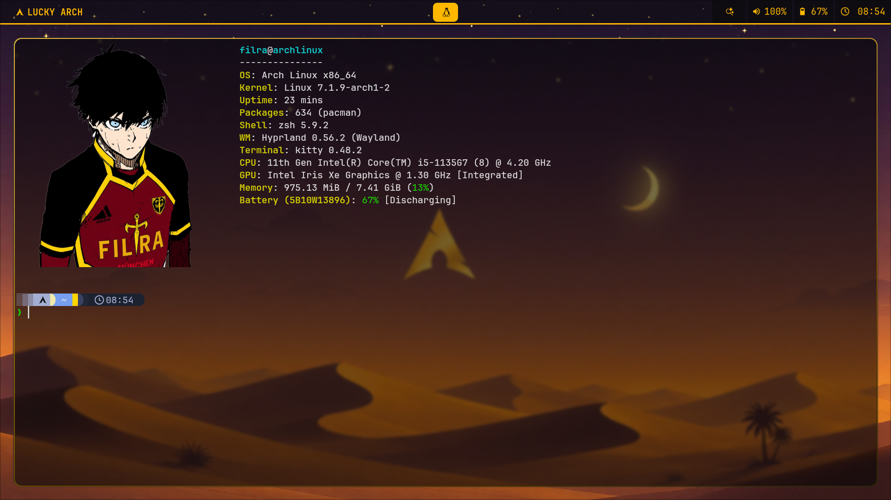
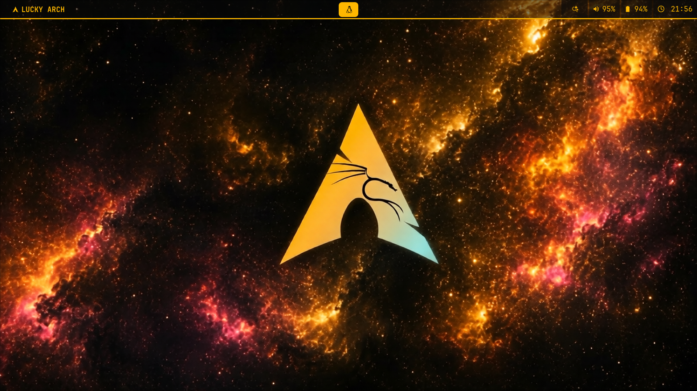

<h1 align="center">🐧 Lucky Arch</h1>

  My personal Arch Linux dotfiles and desktop customizations.

  
  
  
  
  

My personal Arch Linux dotfiles and desktop customizations. I created this repository to save and manage my Arch Linux configuration files and make it easier to restore my setup in the future.

## 🖥️ Setup

- **OS:** Arch Linux
- **Window Manager:** Hyprland
- **Terminal:** Kitty
- **Shell:** Zsh
- **Prompt:** Starship

## Preview 

  
  
  

## 📂 Contents

- `hypr/` — Hyprland configuration
- `waybar/` — Waybar configuration
- `kitty/` — Kitty terminal configuration
- `rofi/` — Rofi configuration
- `fastfetch/` — Fastfetch configuration
- `awww/` — Wallpaper configuration
- `wallpapers/` — Wallpapers
- `.zshrc` — Zsh configuration
- `starship.toml` — Starship prompt configuration

## 🚀 Purpose

This is my personal project to learn Linux customization, manage my dotfiles, and build my own Arch Linux environment.

## 📌 Project Status

This project is currently on hold due to my studies and other commitments. I plan to continue working on it and improve it in the future. 

## ⚠️ Note

These configurations are designed for my personal setup. Some settings may need adjustments on other systems.

## 📜 License

Feel free to explore and learn from my configurations.
